<div align="center">
  
</div>

<div align="center">
  
</div>

<div align="center">
  <br />

  [](#)
  [](#)
  [](#)
  [](#)
  [](https://github.com/SamRonin?tab=followers)
  [](https://github.com/SamRonin/SamRonin/commits/main)

</div>


##  &nbsp;RONIN &nbsp;·&nbsp; The short version

I build **local-first, privacy-first tools** and ship them in public. No telemetry, no accounts, no cloud round-trips — the file stays on your machine, the data stays in your browser. If a feature needs the network, it earns that need first.

Most of my work lives where **the browser** meets **native performance**: Chrome extensions on Manifest V3, and desktop apps on **Tauri v2 + Rust** where FFmpeg-class work has to feel instant. Every UI I ship is **Persian-first and RTL-correct** — not translated afterwards, but designed that way from the first line of code.

<div dir="rtl">
  <p>
    <b>فارسی:</b> من ابزارهایی می‌سازم که <b>اول محلی</b> و <b>اول خصوصی</b> هستند — بدون تلمتری، بدون حساب کاربری، بدون آپلود فایل روی سرور. تمرکزم روی اکستنشن‌های کروم (Manifest V3) و اپلیکیشن‌های دسکتاپ با Tauri v2 و Rust است. رابط کاربری فارسی و راست‌به‌چپ برایم یک اصل است، نه یک قابلیت جانبی. هر چیزی که می‌سازم را علنی و قدم‌به‌قدم منتشر می‌کنم.
  </p>
</div>



##  &nbsp;// Arsenal



##  &nbsp;// Featured work

<!-- AUTO:FEATURED — regenerated from the GitHub API by .github/workflows/update-profile.yml -->
<table>
  <tr>
    <td width="50%" valign="top"><a href="https://github.com/SamRonin/downwise"></a></td><td width="50%" valign="top"><a href="https://github.com/SamRonin/dropshrink"></a></td>
  </tr>
  <tr>
    <td width="50%" valign="top"><a href="https://github.com/SamRonin/Page2LLM"></a></td><td width="50%" valign="top"><a href="https://github.com/SamRonin/profilepack"></a></td>
  </tr>
</table>


##  &nbsp;// The record



##  &nbsp;// Code of the road

<table>
  <tr>
    <td width="33%" valign="top">
      <h3>🛡️ Privacy is architecture</h3>
      <p align="left">Not a checkbox, not a policy page. If the data never leaves the device, there is nothing to leak, sell, or subpoena. <code>0 bytes</code> of telemetry is a feature I can prove.</p>
    </td>
    <td width="33%" valign="top">
      <h3>⚡ Native or nothing</h3>
      <p align="left">Long jobs belong in Rust and FFmpeg, not in a spinning CSS loader. Fast is a design decision made before the first benchmark.</p>
    </td>
    <td width="33%" valign="top">
      <h3>🌐 Persian-first, not Persian-later</h3>
      <p align="left">RTL, Vazirmatn, correct number shaping, honest translations. 90 million people deserve software built for them from pixel one.</p>
    </td>
  </tr>
</table>


##  &nbsp;// Currently

```console
sam@ronin:~$ status

  ▸ shipping   downwise       Smart right-click downloader & real file…
  ▸ shipping   dropshrink     Fast, offline drag-and-drop video & image…
  ▸ shipping   Page2LLM       Extract clean, structured page text as…
  ▸ learning   Rust          ownership, memory model, zero-cost abstractions
  ▸ open to    collabs       local-first tools, RTL/Persian UX, MV3 extensions
```


##  &nbsp;// Reach out

<div align="center">
  <p>Got a local-first idea, an RTL interface that deserves better, or an extension that should exist? Open an issue on any repo — that's my inbox.</p>

  <a href="https://github.com/SamRonin?tab=repositories">
    
  </a>
  &nbsp;
  <a href="https://github.com/SamRonin?tab=stars">
    
  </a>
  &nbsp;
  <a href="https://github.com/SamRonin?tab=followers">
    
  </a>
</div>

<br />

<div align="center">
  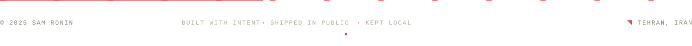
  <br /><br />
  <samp>RONIN &nbsp;·&nbsp; build things &nbsp;·&nbsp; keep them local</samp>
</div>
